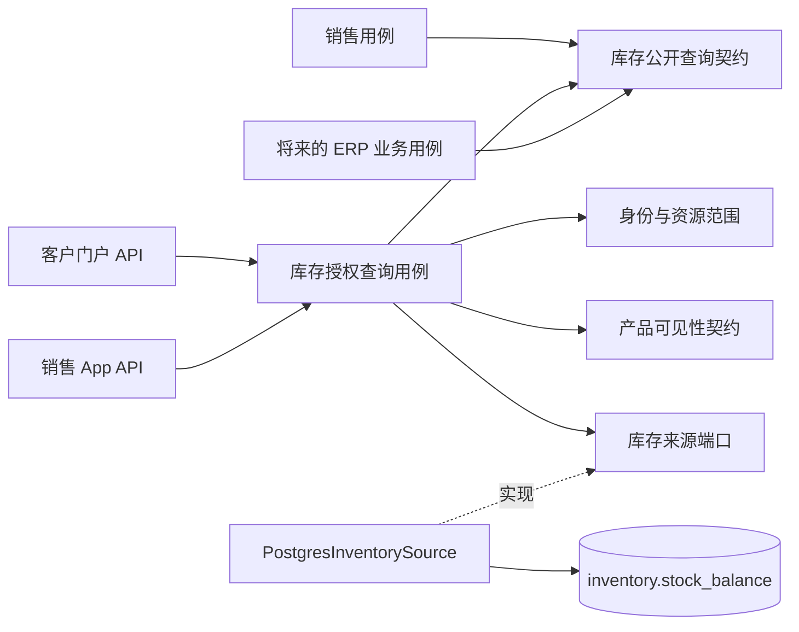

# 架构与分层

2026-11-06。本文件区分当前代码和下一阶段设计；依赖约束以 ADR-0002、0005 和 [模块清单](MODULES.md) 为准。

## 当前实现

采用模块化单体：一个 Maven/JAR、一个 Spring Boot 进程，按业务职责组织包，而不是为三个客户端建三套服务。客户端数量不等于微服务数量。

实际Java包有identity、notification、platform、inventory及CTX-002的crm。小模块可以直接在模块包内组织；CRM按API/应用用例/数据访问分包，不生成四层空目录。AccessRepository、NotificationStore、CustomerBranchRepository使用JDBC，不把只读投影包装成JPA实体。门户迁移状态见 docs/migration/customer-portal.md。

```text
com.htt.management
├── HttManagementApiApplication
├── identity       身份绑定、每请求权限解析、资源范围、审计、/me
├── crm            CTX-002：api / application / infrastructure；显式客户Grant与V6
├── notification   通知消费、历史、投递、SSE，以及 Outbox 转发 worker
├── inventory
│   ├── contract   InventorySource / InventoryAvailability（内部来源端口及事实）
│   └── infrastructure  PostgresInventorySource / UnavailableInventorySource（内部提供方，无 HTTP 入口）
└── platform
    ├── config     基础设施配置
    ├── security   Spring Security 接线（不引用 identity 内部类）
    ├── web        错误响应、requestId
    └── events     DomainEvent / DomainEvents 事务 Outbox 发布契约
```

`OutboxStore` 归 notification：它持有通知 worker 租约并写 notification.audit。业务只通过 DomainEvents 写事务 Outbox，不调用 NotificationStore、FCM、RabbitMQ 或 SSE。

DomainEventsConfiguration由platform独立注册，不受通知开关影响；关闭消费者仍可在业务事务保存Outbox。发布器延迟实例化支持无基础设施的local技术启动，实际业务发布仍需要JDBC/已迁移数据库和可信事务上下文。通知全链路验收见 docs/plans/notification-verification.md。

当前 DomainEvent 包含 recipients，属于已有通知事件信封；它还不是所有 ERP/财务事件的通用总线。未来增加库存同步/财务事件时应单独定义契约和消费者，不复用通知收件人模型承载库存流水。

## 新业务模块的内部职责

有实际用例时才创建以下包；不提前建立空类或通用 CRUD 基类。

| 包 | 职责 | 允许知道什么 |
| --- | --- | --- |
| api | HTTP 参数、格式、响应和兼容映射 | 本模块应用用例；不直接访问其他模块 Repository |
| application | 用例编排、权限检查、事务边界、幂等 | 本模块领域与仓储；其他模块公开契约 |
| domain | 已确认业务规则、值对象、聚合 | Java 类型；不依赖 Web、JPA、RabbitMQ、ERP SDK |
| infrastructure | JDBC/JPA、外部数据适配和实现细节 | 本模块领域/契约；不向外暴露 ORM 对象 |
| contract | 确实需要跨模块调用的窄用例、DTO、提供方端口 | Java 值类型；不暴露数据库表或框架对象 |

简单读用例可以用一个具体应用服务和一个具体 Repository，不必为每个 Service/DAO 配对接口。只有跨实现替换或真实边界需要时才定义接口，例如库存权威来源端口。HTTP Controller 不是跨模块契约。

## 库存与 ERP 的依赖方向



用户本轮已确认 HTT PostgreSQL 为库存唯一权威，三个客户端和后续 ERP 业务共用 stock_balance。catalog 拥有产品/单位，inventory 拥有仓库/数量/流水。业务通过库存用例访问同一记录，不各自修改表。外部 ERPNext 仍未集成；integration 只在未来确有外部契约时实现。

当前实现来源端口、不可变结果、PostgresInventorySource 及不可用实现。数据库实现要求已建立可信 actor/company 的事务上下文，查询相同余额表；缺记录为 UNKNOWN，显式 0 为 KNOWN。端口不是已授权用例：未注册 Bean/HTTP，不能绕过待实现的仓库授权。api/sales 只能调用未来库存应用用例。V5 统一 available=on_hand-reserved-damaged；低库存阈值尚未确定。

已确认方向、字段证据和验收范围见 [ADR-0008](adr/0008-shared-postgresql-inventory.md)，更新 [ADR-0007](adr/0007-inventory-and-erp-boundary.md) 的“来源未知”历史结论。V5 已在专用验证库验收；正式订单出库过账与三端接线仍未实现。

## 事务、权限和故障

- 写事务由应用用例拥有；本模块变更、业务幂等、审计和 Outbox 原子提交。外部 ERP/HTTP/RabbitMQ/FCM 调用不在数据库事务内；跨系统写操作需要独立命令、幂等和恢复设计。
- 查询先校验已验证身份、动作权限、公司及资源范围。公司 RLS 只是纵深保护，不能替代客户/门店/仓库授权。列表、聚合、导出与详情使用同一授权集合。
- 正式订单所有入口复用 MANAGEMENT + order:create + 数据范围守卫；CUSTOMER、SALES 均不能创建。角色名、App 来源、可用库存数量不赋予订单权限。
- 对外保留 ApiError：`code,message,requestId,retryable,fieldErrors`。认证 401、范围拒绝 403、依赖不可用 503。不能用空列表或零库存掩盖来源故障。
- 库存读取不承诺锁货；报价、订单、履约、发票和收入确认有独立生命周期。预留/扣减/计价未确认前不实现。

## 可执行的边界

`ModuleArchitectureTests` 读取生产字节码，检查模块名称/依赖方向、无环、跨模块仅使用公开契约、domain/contract 不依赖框架/外部传输，以及库存来源端口不得被外部调用。当前平铺 identity 的公开类型采用明确名单；仅 NotificationAccess/NotificationConfiguration（含 ApiConfiguration 接线类）可沿用 AccessRepository，用于已有 SSE 撤权检查及接线，不将 DAO 普遍公开。

测试保留未来模块的名称和依赖约束，但不声称这些模块已实现。domain/contract 规则已覆盖实际库存契约，其他领域包尚不存在。检查不解析 SQL，不证明 RLS 或任意 SQL 已符合所有权；真实数据库测试和代码审查仍必需。

仅增加测试依赖 `com.tngtech.archunit:archunit:1.5.1`，不引入测试引擎或运行时组件。官方提供普通单元测试用法及字节码依赖检查：[安装说明](https://www.archunit.org/getting-started)、[用户指南](https://www.archunit.org/userguide/html/000_Index.html)、[1.5.1 发布记录](https://github.com/TNG/ArchUnit/releases/tag/v1.5.1)。Java 21 与本项目的实际兼容性由本轮 Maven 验证，不假定 Boot BOM 管理该版本。

```powershell
.\mvnw.cmd -B -ntp '-Dtest=ModuleArchitectureTests' test
.\mvnw.cmd -B -ntp verify
```

普通 verify 不启动远程基础设施；真实库存数据库测试在专用 validation 库执行，V5 新增四表。没有新增 HTTP API。Keycloak 的开发部署与生产迁移见 deploy/keycloak/DEPLOYMENT.md。
