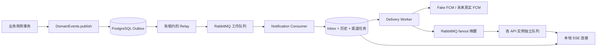

# 通知模块：可靠投递、浏览器恢复与运行说明

日期：2026-11-06。本轮复核后71项普通测试/构建通过，7项真实PostgreSQL+RabbitMQ容器测试通过，新增真实HTTP/SSE、RSA身份、RLS及补偿恢复的同链路验证。此前56/11/6为早期阶段记录。领域事件发布Bean已独立于通知开关；详见 [本轮验收](plans/notification-verification.md)。FCM仍为Fake，无真机验收，不代表十万在线容量。

## 版本与依赖证据

Boot **4.1.2** 的 RabbitMQ AMQP 0.9.1 Starter 实际为 `spring-boot-starter-amqp`。官方在 4.1.0-M3 尝试更名，4.1.0-M4 撤回，安排到 4.2；4.2 的同名 amqp Starter 才指向通用 AMQP 1.0。不能将 4.2 文档的坐标和包名直接套到本项目。

本轮重新解析：starter-amqp4.1.2 → spring-boot-amqp4.1.2 → spring-rabbit4.1.2 → com.rabbitmq:amqp-client5.30.0，无Qpid。没有混装其他版本的starter-rabbitmq。依据：[M4官方撤回说明](https://github.com/spring-projects/spring-boot/wiki/Spring-Boot-4.1.0-M4-Release-Notes)、[4.1.2文档](https://docs.spring.io/spring-boot/reference/messaging/amqp.html)。本轮依赖树`.cache/notification-review-dependencies.log`。

## 事务与交付语义



业务模块只依赖 `platform.events.DomainEvent/DomainEvents`，不依赖 NotificationChannel、RabbitTemplate、FCM 或 SseEmitter。`publish` 要求已存在业务事务，并使用业务用例设置的可信 actor/company 事务上下文；业务写入与 Outbox 一起提交或回滚。当前没有为订单等未实现模块伪造生产用例或发送通知的 HTTP 后门。

DomainEventsConfiguration在platform独立注册发布器，不受htt.notification.enabled/worker开关控制。通知停止时业务事务仍可持久化Outbox，恢复后再转发；不需要业务依赖通知配置。发布器延迟创建仅支持无JDBC的local技术启动，实际调用仍必须有数据源、已迁移schema与业务事务。

事件有显式版本、唯一 ID、公司/资源上下文和接收者，最多 100 个去重接收者，载荷最多 16 KiB。消费者重新验证接收者当前账户、公司成员、notification:read 和客户/门店范围；不能仅凭事件中的接收者 ID 放行。业务负责选择候选接收者，notification 负责当前授权校验。

Relay 用短事务 `FOR UPDATE SKIP LOCKED` 领取，设置 lease_id/lease_until；事务外发持久消息。收到 publisher confirm 且未 mandatory return 后才用原 lease_id 标记 PUBLISHED。发布/确认超时可能实际上已发送，因此允许重发。数据库状态只能由当前租约更新，进程重启后到期租约可重新领取。

Consumer 在一个事务中写唯一 inbox、消息历史、每个渠道/设备的任务及审计，提交后手动 ACK。同一 event_id + 相同语义载荷为重复消费，不新建通知；同一 ID 被用于不同事实则作为错误处理。散列使用规范化事件 JSON，空白或 JSONB 字段排序差异不制造冲突。

至少一次投递不等于端到端恰好一次。消费者提交后 ACK 前、外部提供方成功后本地记录前的崩溃都可能重复；浏览器/移动端使用 notification id 去重。SSE cursor 用于恢复，不作为跨账户的全局 ID。

## 重试、死信与状态

- Outbox/渠道：默认最多 5 次已领取尝试；失败指数退避并加抖动，最大约 60 秒后再尝试，持久化 available_at；耗尽进入数据库 DEAD。租约默认 60 秒，网络确认默认 5 秒，批量 10。
- Consumer：工作队列 → 分级 TTL 重试队列 → 工作队列；默认延迟 2/4/8/16 秒。每次失败先记录审计，确认重试或 DEAD 队列接收后才 ACK 原消息；转移失败时原消息保留，并暂停 1 秒避免热循环。
- 工作、重试和死信使用持久 quorum queue。重试队列显式使用 at-least-once dead-lettering、reject-publish 溢出策略，避免依赖默认可能丢失的死信转发。工作/死信队列设置 x-delivery-limit=-1，避免 broker 在应用故障重入时按默认次数无 DLX 丢弃消息。
- 渠道永久错误立即 DEAD；INVALID_DEVICE 会在同一事务中禁用对应设备。瞬时错误才重试；Fake Provider 无外部错误、无网络调用。
- 历史有 UNREAD/READ（read_at）；任务有 PENDING/IN_FLIGHT/SENT/SIMULATED/SKIPPED/DEAD；Outbox 有 PENDING/IN_FLIGHT/PUBLISHED/DEAD。SENT 对 SSE 仅表示唤醒消息获得 broker 确认，不表示浏览器已接收；SIMULATED 永不声称真机送达。

审计记录事件/通知 ID、动作、状态、次数、时间及安全错误码，不记录令牌、设备 token 或事件正文。注册设备的 token 是敏感数据，API 返回设备 ID，不回显 token；生产数据库及备份应按秘密数据保护，当前没有实现应用层 token 加密。

死信/DEAD 不会自动无限循环重放。管理员先修复原因，核对审计与幂等 ID，再经受控运维将 RabbitMQ DEAD 消息重放到 WORK，或重置明确目标的数据库 DEAD 行（保留尝试历史和新增运维审计）。当前没有对外开放重放 API；不得通过删 inbox、清队列或直接改写已处理事件来实现重放。详细运维授权及保留周期待确认。

参考：[Publisher confirms/returns](https://docs.spring.io/spring-amqp/reference/amqp/template.html)、[quorum at-least-once dead-lettering](https://www.rabbitmq.com/docs/quorum-queues)。真实 broker 的发布、消费、重试、死信与广播已在临时容器测试通过。

## 数据所有权与权限

V4新增platform.domain_outbox和notification的inbox、recipient_cursor、message、device、delivery、audit，共7表；未改写V1～V4。后续库存V5增加四表，当前共有28张业务/安全表。本轮临时容器应用V1～V5成功，未访问既有验证库/主库。notification:read/device没有自动分配给真实用户。

API 查询设置事务内的可信 actor/company/portal grant，历史和已读更新由 RLS 再检查资源范围。客户必须使用自己的有效 X-Portal-Grant-Id；公司级通知仅发给明确拥有公司范围的员工。设备增删仅限本人所选公司。后台 worker 用事务内 `htt.notification_worker=true` 访问工作表，客户端无法通过 HTTP 设置；数据库运行账号处于可信服务边界，不交给前端。新表无 TRUNCATE/DELETE 权限，通知审计运行账号仅追加。

游标由 `(company_id,user_id)` 的 recipient_cursor 行在通知事务内加锁递增，锁保持至提交；同一接收者的后续事务不能先提交更高 cursor。历史查询先读已提交 highWatermark，再查询至该上界，过滤不可见项后仍可推进 cursor。普通全局序列不具备此保证。当前不自动删除历史；未来归档/保留期必须保留可解释的游标水位及恢复协议。

## HTTP 与 SSE

同样的本人接口在 `/api/v1/notifications` 和 `/api/portal/v1/notifications` 下提供：

| 方法/相对路径 | 权限 | 行为 |
| --- | --- | --- |
| GET / | notification:read | after（默认 0）、limit（1～200），返回 items/nextCursor/highWatermark/hasMore |
| GET /stream | notification:read | Bearer + 公司头；门户还需 Grant；Last-Event-ID 为当前接收者 cursor |
| PATCH /{id}/read | notification:read | 本人当前可见消息；不存在/不可见返回 404 |
| POST /devices | notification:device | 注册 ANDROID/IOS token，返回设备 ID |
| DELETE /devices/{id} | notification:device | 幂等停用本人设备；退出或 token 更新时客户端调用 |

没有任意 userId 查询参数。身份从已验证 JWT 取得；错误公司/Grant 不会切换用户。cursor 不合法返回 400，超过本人历史水位返回 409，连接过多返回 429，未登录 401、无权限 403。建立流前错误返回 JSON；建立流后的失效会关闭连接，下一次重连重新鉴权。

SSE 事件名 notification，id 为 cursor，data 包含稳定 notification id。cursor 事件仅推进恢复位置；注释 heartbeat 默认每 15 秒发送，retry 为 3 秒。JWT 到期、账户禁用、撤权或 Grant 失效在下一次 drain/心跳复核时关闭连接，不承诺中断已在发送中的单帧。

默认每实例最多 1000 条、每用户/公司最多 2 条连接；4 个写线程、256 个待写任务，单次读取最多 100 条，15 分钟连接寿命，单轮处理 5 秒超时后关闭。慢连接、队列饱和或断网清理连接；没有无限消息内存队列，也不长期占用 JDBC 连接。Servlet/网络写可能受底层阻塞影响，需结合代理 send_timeout 和实际压测；这些默认值不是十万 SSE 连接的容量承诺。

当前 Bearer 协议下，原生 EventSource 无法附带所需自定义 Authorization/公司/Grant 请求头；使用 fetch streaming 或可设置请求头的客户端。不得在 URL 查询参数中传 token。示意：

```javascript
const headers = {
  Authorization: `Bearer ${accessToken}`,
  'X-Company-Id': selectedCompanyId,
  'Last-Event-ID': String(lastCursor),
  Accept: 'text/event-stream',
};
// 门户增加 X-Portal-Grant-Id。accessToken 不保存到 URL；cursor 按用户/公司/Grant 隔离。
const response = await fetch('/api/v1/notifications/stream', { headers, signal });
// 按 SSE 规范增量解析 response.body，处理 UTF-8 分段与多行 data；收到完整帧后保存 id。
```

断线后先确认 token 有效，使用最后完整事件的 Last-Event-ID 重连，按指数退避+抖动限制重连风暴；401 刷新身份后重试，403 停止连接并刷新授权，429 退避，409 重新查询本人历史。首次打开可从 after=0 分页取历史，保存 nextCursor 后建立流；断线/重连期间的通知由数据库补读。跨域部署另行精确配置允许的 origin/headers，不全局开放 CORS。

Nginx 示例见 `deploy/nginx/notification-sse.conf.example`：关闭 proxy_buffering/cache/gzip，proxy_read_timeout=75s 大于心跳周期，send_timeout=30s；后端也返回 Cache-Control:no-store 和 X-Accel-Buffering:no。实际负载均衡器 idle timeout 也必须大于心跳间隔。[Nginx 官方说明](https://nginx.org/en/docs/http/ngx_http_proxy_module.html#proxy_buffering)。本轮没有修改远程 Nginx。

## 多实例与离线边界

业务事件只有一个竞争消费的 WORK 队列，保证分工处理。SSE 唤醒使用独立 fanout exchange，每个 API 实例建立自己的独占、自动删除队列；一个通知的唤醒会到所有实例，再由持有该用户连接的实例补读本人历史。消费者不把通知正文广播到所有实例。

唤醒不是持久历史：API 宕机或短暂丢失 fanout 信号后，重连和周期心跳仍补读数据库，因而不会依赖广播恰好一次。实例重启不恢复旧 socket；客户端重新连接即可。当前各实例心跳会查询数据库，十万活跃浏览器前必须压测并设计分批/抖动/容量预算，不能只增大连接上限。

FCM 面向 Android/iOS 后台或 App 未打开的推送；浏览器 SSE 只在页面在线且连接存在时工作。浏览器离线网页推送需要另行实现 Web Push（Service Worker、订阅和 VAPID 等），本轮未实现。

## Fake 与未来 Firebase/APNs 接线

目前 FCM channel 唯一实现是 FakePushProvider，返回 SIMULATED，不访问 Firebase，不伪造凭据；即使部署时填入 Firebase 环境变量也不会变成真实发送。

未来单独实现 FcmChannel：选兼容依赖，通过运行环境身份或密钥管理获取服务账号权限，按环境配置 Firebase project；Android 注册应用并接入设备 token 生命周期；iOS 配置 Bundle ID、推送能力、APNs key/证书及 Firebase APNs 关联。不能把 APNs 私钥交给 Java 客户端或提交仓库。

FCM payload 以 notification id 和必要路由 ID 为主，敏感内容在 App 鉴权后读取。HTTP/provider 接受不等于真机展示；网络超时结果未知，移动端按 notification id 去重。UNREGISTERED 可映射 INVALID_DEVICE；INVALID_ARGUMENT 需要先确定不是载荷错误，不能一律删除设备；429/503 等瞬时失败退避并考虑 Retry-After，凭据错误需报警并停止盲目重试。[Apple 设置](https://firebase.google.com/docs/cloud-messaging/ios/get-started)、[FCM 错误](https://firebase.google.com/docs/cloud-messaging/error-codes)。Android/iOS 真机送达、后台策略、权限弹窗和 APNs 尚未验收。

## 配置、测试与回滚

功能默认关闭。启用前需要 V4、专用 RabbitMQ vhost/最小权限账号、确认拓扑兼容；API 实例还需要真实身份配置。配置 `HTT_NOTIFICATION_ENABLED=true`，worker 实例再设 `HTT_NOTIFICATION_WORKERS_ENABLED=true`。独立 worker 可关闭认证，但没有开放 HTTP 业务接口。RabbitMQ 连接凭据用 Spring 环境变量，示例见 .env.example；跨主机生产连接使用受信任 TLS。

通知模板默认空，未知事件会重试后进入死信，不默认启用未知业务。部署配置经审查后按实际领域事件添加静态、不含敏感内容的文案，示意键用方括号保留点号：

```yaml
htt:
  notification:
    templates:
      "[your.reviewed.event]":
        title: "Reviewed title"
        body: "Reviewed non-sensitive text"
```

模块实现包括platform/events（DomainEvent、DomainEvents、独立发布配置）、notification（含OutboxStore租约/转发审计、Consumer、Channel、Fake、SSE、历史/HTTP）及V4。本轮仅修改发布配置接线、两项配置测试、NotificationPipelineIT及文档；未改迁移、业务接口、前端或ERPNext。

```powershell
$env:MAVEN_USER_HOME = Join-Path (Get-Location) '.cache/maven'
.\mvnw.cmd -o -B -ntp '-Dmaven.repo.local=.cache/repository' verify
# 已授权的专用 PostgreSQL；拒绝主库。
. ./scripts/database/Use-DatabaseEnvironment.ps1 -Target Validation -Migration
.\mvnw.cmd -o -B -ntp '-Dmaven.repo.local=.cache/repository' -Ppostgres-it '-Dhtt.test.database=dedicated' verify
# 需要本机/CI Docker；同时启动一次性 PostgreSQL 和 RabbitMQ，禁止自动回退其他服务。
.\mvnw.cmd -B -ntp '-Dmaven.repo.local=.cache/repository' -Pnotification-it verify
# 用户授权的 Linux Docker 服务器：在服务器主机上用隔离 runner 执行，不开放 Docker TCP。
# sh deploy/infra/run-notification-tests.sh /absolute/htt-management-api-checkout
```

本轮实际结果：71项普通测试及JAR构建通过，7项真实broker/PG容器测试全部通过。新增用例把真实RSA校验、HTTP/SSE、实际身份仓储/审计/RLS、Outbox/Rabbit/消费和游标补偿连在一起验证；测试公钥取代真实IdP取钥，不代表Keycloak或真机验收。两个临时容器已清理，既有PG/业务主库未使用。报告`.cache/remote-reports/NotificationPipelineIT-review.txt`、`notification-review-tests.log`。历史56/11/6和本机无Docker记录保留于旧报告。

回滚关闭通知和 worker 开关，停止对应 listener/连接；保留 Outbox/历史/死信及审计等待恢复。V4 已应用不可改写，数据库修复需新迁移；不能删除队列、clean 或通过丢弃 Outbox 恢复服务。用户后续授权 SSH 部署后，已新建独立 HTT RabbitMQ/Redis 测试栈；生产脚本及真实 TLS/备份验证见 [基础服务部署](../deploy/infra/README.md)。主库、ERPNext 和现有 PostgreSQL 服务未操作；未部署 API、Nginx 或 Firebase。实际身份/模板/初始权限、FCM/APNs 真机、压力/故障与保留期仍待验收。
